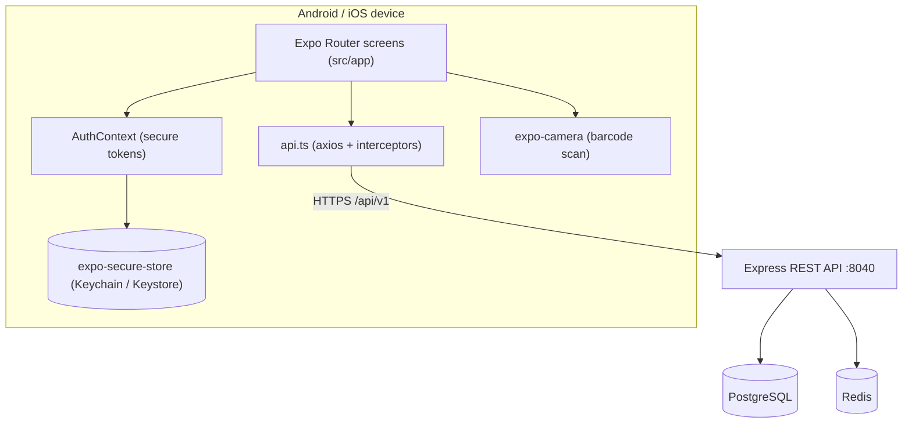

# Multi-Platform Inventory Management System — Mobile Client (Android & iOS)

A single **Expo (React Native) + TypeScript** app that targets **Android and iOS** and reuses the
existing MPIMS REST API, authentication, RBAC permissions, and branch-selection flow.

**Status:** In development. Scaffolded with **Expo Router**; implemented so far: authentication,
branch selection, an authenticated **five-tab** shell (Dashboard, Products, POS, Sales, More),
the products catalog (products CRUD, categories, units of measure, price history), POS + sales
history, and read-only inventory plus stock in/out with barcode scanning. The goal is web/desktop
**feature parity minus** sync/offline, message queue, SMS balance, business/system settings, sync
logs, and audit logs. The remaining modules (inventory depth, procurement, administration, reports)
are not implemented yet.

> Companion documents: [`../INSTALLATION.md`](../INSTALLATION.md), [`../RUNNING.md`](../RUNNING.md),
> [`../TECHNICAL_MANUAL.md`](../TECHNICAL_MANUAL.md), [`../USER_MANUAL.md`](../USER_MANUAL.md).

---

## 1. Overview

The repository already ships a **REST API** (`backend/`), a **React web client** (`web-client/`),
and an **Electron desktop client** (`desktop-client/`). This is a fourth client — one Expo codebase
that builds for Android and iOS.

The mobile app reuses the existing API, authentication, RBAC permissions, and branch-selection flow.
It is **online-only** — the sync/offline layer is intentionally excluded. **No backend changes are
required.**

| Aspect | Decision |
|---|---|
| Framework | Expo (React Native) + TypeScript |
| Routing | Expo Router (file-based, routes in `src/app/`) |
| Scope | Web/desktop feature parity **minus** sync/offline, message queue, SMS balance, business/system settings, sync logs, and audit logs |
| Offline | **Excluded** — mobile is online-only (no `/sync/*`, no outbox) |
| Currency / branding | Read-only from `GET /business/public` (the management page stays web/desktop-only) |
| Code sharing | Dedicated `mobile-client/` with its own API module (no shared workspace package) |

---

## 2. Existing system (verified)

### 2.1 Components

| Component | Technology | Role | Source |
|---|---|---|---|
| API | Node.js 22 + Express 5 | REST endpoints under `/api/v1` | `backend/src/app.js` |
| Queue worker | Node.js | Email/SMS sending, low-stock scans | `backend/src/worker/queue.worker.js` |
| Database | PostgreSQL | Persistent store | `database/` |
| Cache / rate limit | Redis | Report cache, permission cache, rate limiting | `docker-compose.yml` |
| Web client | React 19 + Vite + TypeScript | Browser SPA | `web-client/` |
| Desktop client | Electron + same React app | Native printing + barcode scanner | `desktop-client/` |

### 2.2 API facts relevant to mobile

- **Base path:** `/api/v1` (mounted in `backend/src/app.js`).
- **Auth:** JWT **access token** (Bearer header) + **refresh token** rotation. The refresh token is
  accepted **in the JSON body** or an HttpOnly cookie (`backend/src/routes/auth.routes.js`) — so
  native clients do not depend on cookies.
- **Device identity:** every request may send an `X-Device-Id` header (`web-client/src/services/api.ts`).
- **CORS:** `app.use(cors())` — open, so device origins are accepted (`backend/src/app.js`).
- **Ports:** API listens on `PORT || 8040` (`backend/server.js`). Vite dev server proxies `/api` and
  `/uploads` to `http://localhost:8040` (`web-client/vite.config.ts`).

### 2.3 Verified auth/identity endpoints

| Method | Path | Body / Notes |
|---|---|---|
| POST | `/api/v1/auth/login` | `{ usernameOrEmail, password }` → `{ accessToken, refreshToken, user }` |
| POST | `/api/v1/auth/refresh` | `{ refreshToken }` → new tokens |
| POST | `/api/v1/auth/logout` | Bearer required |
| GET | `/api/v1/auth/my-branches` | Bearer required |
| POST | `/api/v1/auth/select-branch` | `{ branchId }` → new tokens + `branch` + `user` |
| GET | `/api/v1/auth/me` | Bearer required |
| GET | `/api/v1/auth/me/permissions` | → `{ permissions: string[] }` |
| GET | `/api/v1/health` | Health check |

### 2.4 Offline/sync
> Mobile uses offline cache + outbox with immediate sync. GETs are cached and served offline on failure; mutations are queued and replayed on connectivity (reconnect, app foreground, boot, periodic probe).
| Method | Path | Purpose |
|---|---|---|
| GET | `/api/v1/sync/:entity/pull` | Per-entity pull (`?since=&branchId=`) |
| GET | `/api/v1/health` | Health probe |

### 2.5 Offline pattern (mobile)
- Response cache (SQLite) for GETs; served on network/5xx errors.
- Outbox queues mutations when unreachable; replayed via raw axios on reconnect/app-foreground/boot; periodic `healthCheck()` probe.
- Offline sales ledger with `local_transaction_id` → `server_sale_id` mapping.
- Hydration via `/sync/:entity/pull` (branch-scoped where applicable).

### 2.6 Permission codes per screen (verified in `web-client/src/App.tsx`)

| Screen | Permission code |
|---|---|
| Dashboard | (authenticated) |
| Products | `VIEW_PRODUCTS_PAGE` |
| Categories / Units of measure | `VIEW_CATEGORIES` |
| Inventory | `VIEW_INVENTORY` |
| Inventory movements | `MANAGE_INVENTORY` |
| Inventory history / Low stock / Batches / Transfers | `VIEW_INVENTORY` |
| Price history | `VIEW_PRODUCTS_PAGE` |
| Sales / sale detail | `VIEW_SALES` |
| Void / refund a sale | `VOID_SALE` |
| POS | `CREATE_SALE` |
| Purchases | `VIEW_PURCHASES` |
| Suppliers | `VIEW_SUPPLIERS` |
| Customers | `VIEW_CUSTOMERS_PAGE` |
| Branches | `MANAGE_BRANCHES` |
| Expenses | `VIEW_EXPENSES` |
| Reports / expiry report | `VIEW_REPORTS_PAGE` |
| Notifications | (authenticated) |
| Notifications (create) | `MANAGE_NOTIFICATIONS` |
| Users / Roles | `MANAGE_USERS` |
| **Excluded:** sync, sync logs, audit logs, message queue, SMS balance, business/system settings | — |

`Administrator` and `Business Owner` bypass all permission checks
(`web-client/src/contexts/AuthContext.tsx`, mirrored in `src/contexts/AuthContext.tsx`).

---

## 3. Architecture



### 3.1 Folder layout (current)

```
mobile-client/
  app.json                    # Expo config: scheme, plugins, typed routes
  .env.example                # committed template for EXPO_PUBLIC_API_BASE_URL
  .env.local                  # local override (git-ignored, no secrets)
  src/
    app/                      # Expo Router routes — every file is a screen
      _layout.tsx             # root layout: SafeAreaProvider + Business + Auth + Stack
      +not-found.tsx
      (auth)/
        login.tsx             # /login (password visibility toggle)
      select-branch.tsx       # /select-branch (?mode=switch from "Change branch")
      (app)/
        _layout.tsx           # authenticated Tabs + guard; builds the TabBar item list
        index.tsx             # / (dashboard + Change branch)
        pos.tsx               # /pos (point of sale + scan)
        products/             # nested Stack (owns its headers)
          _layout.tsx         # headers for the product stack
          index.tsx           # /products (list, search, pagination)
          new.tsx             # /products/new
          [productId].tsx     # /products/:productId (detail / edit / deactivate)
          categories.tsx      # /products/categories
          units-of-measure.tsx# /products/units-of-measure
          price-history.tsx   # /products/price-history
        inventory.tsx         # /inventory (reached from More)
        stock-movements.tsx   # /stock-movements (stock in/out + scan; reached from More)
        sales/
          _layout.tsx         # nested Stack (headers)
          index.tsx           # /sales (list + filters + load more)
          [saleId].tsx        # /sales/:saleId (detail, void/refund)
        more.tsx              # /more (profile, Change branch, Inventory/Stock, sign out)
    config/
      permissions.ts          # permission codes (page vs data)
    components/
      PermissionGate.tsx      # route-level permission guard
      LoadingScreen.tsx       # branded splash: business logo + name + spinner
      BarcodeScanner.tsx      # expo-camera modal barcode scanner
      ProductForm.tsx         # shared product create/edit form
      TabBar.tsx              # custom 5-item bottom tab bar (raised circular POS)
    services/
      secureTokens.ts         # expo-secure-store wrapper (tokens, device id)
      api.ts                  # axios instance + refresh queue + endpoints
    hooks/
      useCurrency.ts          # reads currency symbol from /business/public
    contexts/
      AuthContext.tsx         # session, permissions, branch selection
      BusinessContext.tsx     # business name + logo from /business/public (cached)
    theme/
      theme.ts                # design tokens
```

Non-route code (services, contexts, theme) lives **outside** `src/app/`, per Expo Router
convention. Route groups `(auth)` and `(app)` are transparent in the URL.

### 3.2 Library mapping

| Web client | Mobile equivalent |
|---|---|
| `localStorage` (tokens) | `expo-secure-store` (access + refresh stored under **separate keys**) |
| `localStorage` (prefs/branch) | `expo-secure-store` JSON blob |
| `axios` | `axios` (unchanged) |
| `react-router-dom` | Expo Router |
| `node-hid` | `expo-camera` barcode scanning |
| React Context | React Context (unchanged) |
| `idb` / outbox / sync | **not ported** — mobile is online-only |

> **iOS SecureStore note:** values are limited to roughly 2048 bytes, which is why `accessToken` and
> `refreshToken` are stored under separate keys rather than one JSON blob.

### 3.3 Branding (login + splash)

The login screen and the JS splash show the **Business Settings** logo and business name, read from the
unauthenticated `GET /business/public` through `BusinessContext`
(`src/contexts/BusinessContext.tsx`).

- The last-seen `{ name, logo }` is cached in `expo-secure-store`, so an offline cold start still shows
  branding. On failure (or when unset) the UI falls back to the default name `"Inventory Manager"`.
- The logo is stored relative, so it is resolved against the API origin with `resolveImageUrl`.
- This is a **JS** splash (`src/components/LoadingScreen.tsx`), shown while auth/session state
  resolves. The **OS-level** splash is static (baked at build time) and cannot render runtime Business
  Settings data, so no `expo-splash-screen` configuration is used.

---

## 4. Prerequisites

- **Node.js 20+** (22 LTS recommended) — matches the backend.
- **npm**.
- **Expo Go** app (quick testing) or Android Studio / Xcode for native builds.
- **Android Studio** (Android emulator) and/or **Xcode** (iOS simulator, macOS only).
- A running backend API (`backend/`, default `http://localhost:8040`).
- For store builds: an **Expo/EAS account**, **Google Play Console**, **Apple Developer** account.

---

## 5. Setup

```sh
cd mobile-client

# Install dependencies (already declared in package.json)
npm install

# Add a new Expo module (ALWAYS use `expo install` so the SDK-compatible
# version is chosen)
npx expo install <package>
```

Current dependencies: `expo`, `expo-router`, `expo-secure-store`, `expo-camera`, `expo-status-bar`,
`expo-linking`, `expo-constants`, `expo-crypto`, `expo-font`, `expo-image-picker`, `expo-dev-client`,
`expo-print`, `expo-sharing`, `@expo/vector-icons`, `axios`, `react-native-safe-area-context`,
`react-native-screens`, `react-native-web`, and `react-native-thermal-receipt-printer`
(ESC/POS thermal printing — requires a development build; see §8.3).

> `expo-sqlite` is still declared but currently **unused** (a leftover from the excluded offline
> layer) and can be removed.

### 5.1 API base URL configuration

The app reads `EXPO_PUBLIC_API_BASE_URL` (see `.env.example`). Copy it to `.env.local` and set the
value for your target:

| Environment | Base URL |
|---|---|
| Android emulator → host | `http://10.0.2.2:8040/api/v1` |
| iOS simulator → host | `http://localhost:8040/api/v1` |
| Physical device (dev) | `http://<host-LAN-IP>:8040/api/v1` |
| Production | `https://<your-domain>/api/v1` (HTTPS required for stores) |

If the variable is unset, the app falls back to `http://localhost:8040/api/v1`.

> `localhost` on a physical device points at the device itself, not the dev machine. Use the LAN IP
> or an Expo tunnel.

---

## 6. Environment variables

### 6.1 Mobile — `.env.local`

| Variable | Example | Notes |
|---|---|---|
| `EXPO_PUBLIC_API_BASE_URL` | `http://10.0.2.2:8040/api/v1` | Public (bundled) API base, includes `/api/v1` |

Only variables prefixed with `EXPO_PUBLIC_` are exposed to the app bundle, so **never put real
secrets in these files** — they are embedded in the client.

### 6.2 Backend (existing) — `backend/.env`

Verified against `backend/.env.example`:

| Variable | Default | Notes |
|---|---|---|
| `NODE_ENV` | `development` | |
| `PORT` | `8040` (`backend/server.js`) | Example file shows `3000` — **the example and the runtime default disagree** |
| `DATABASE_URL` | — | Or discrete `PG_HOST`/`PG_PORT`/`PG_DATABASE`/`PG_USER`/`PG_PASSWORD` |
| `ACCESS_TOKEN_SECRET` | — | **Required**; strong random value |
| `REFRESH_TOKEN_SECRET` | — | **Required**; a different value |
| `ACCESS_TOKEN_TTL` | `15m` | |
| `REFRESH_TOKEN_TTL_DAYS` | `30` | |
| `SESSION_INACTIVITY_TIMEOUT_MINUTES` | `30` | |
| `REDIS_URL` | `redis://127.0.0.1:6379` | |
| `REPORT_CACHE_TTL` | `300` | |
| `AGOOSMS_API_URL` / `AGOOSMS_API_KEY` / `AGOOSMS_SENDER_ID` | — | SMS disabled when blank |
| `COOKIE_SECURE` | `false` | `true` only behind HTTPS |

Root `.env` (Docker Compose) additionally defines `POSTGRES_*`, `SEED_ADMIN_*`, `SEED_BRANCH_NAME`,
`WEB_PORT` (default 80), `API_PORT` (8040), and SMTP `Email_*`. See
[`../INSTALLATION.md`](../INSTALLATION.md) for the full table.

> **Never commit real secrets.** Use placeholders and generate values with:
> `node -e "console.log(require('crypto').randomBytes(64).toString('hex'))"`

---

## 7. Running

```sh
# 1. Start the API (from the repo root)
cd backend
npm run dev                       # API on http://localhost:8040

# 2. Start the mobile app
cd mobile-client
npx expo start                    # press "a" for Android, "i" for iOS
```

Useful checks (run from `mobile-client/`):

```sh
npx tsc --noEmit                  # typecheck
npx expo lint                     # lint
npx expo-doctor                   # dependency / config diagnostics
npx expo install --fix            # fix incompatible package versions
```

---

## 8. Screen map & status

| # | Screen | Route | Permission | Status |
|---|---|---|---|---|
| 1 | Login | `/login` | public | Implemented |
| 2 | Branch selection | `/select-branch` | authenticated | Implemented |
| 3 | Dashboard | `/` | authenticated | Implemented (basic) |
| 4 | Products (list, create, edit, deactivate) | `/products` | `VIEW_PRODUCTS_PAGE`, `CREATE_PRODUCT` | Implemented |
| 5 | Inventory | `/inventory` *(via More)* | `VIEW_INVENTORY` | Implemented (read-only) |
| 6 | Stock in / out + scan | `/stock-movements` *(via More)* | `MANAGE_INVENTORY` | Implemented |
| 7 | POS / Sales + scan | `/pos` | `CREATE_SALE` | Implemented |
| 8 | Sales list / sale detail (+ void / refund) | `/sales` | `VIEW_SALES`, `VOID_SALE` | Implemented |
| 9 | Categories · Units of measure · Price history | `/products/categories`, `/products/units-of-measure`, `/products/price-history` | `VIEW_CATEGORIES`, `MANAGE_CATEGORIES`, `VIEW_PRODUCTS_PAGE` | Implemented |
| 10 | Inventory: history, low stock, batches, transfers | — | `VIEW_INVENTORY` | Planned (F) |
| 11 | Procurement & parties: purchases, suppliers, customers, expenses | — | `VIEW_PURCHASES`, `VIEW_SUPPLIERS`, `VIEW_CUSTOMERS_PAGE`, `VIEW_EXPENSES` | Planned (G) |
| 12 | Administration: branches, users, roles, notifications | — | `MANAGE_BRANCHES`, `MANAGE_USERS`, `MANAGE_NOTIFICATIONS` | Planned (H) |
| 13 | Reports / expiry report | — | `VIEW_REPORTS_PAGE` | Planned (I) |
| 14 | Profile (More) | `/more` | authenticated | Implemented |

**Excluded from the mobile client** (web/desktop only): sync & offline, message queue, SMS balance,
business settings, system settings, sync logs, audit logs.

> The bottom bar renders a fixed set of five items built in `src/app/(app)/_layout.tsx`; an item whose
> permission the role lacks is omitted there, and every protected route is additionally wrapped in
> `PermissionGate`. Screens without a tab (`inventory`, `stock-movements`) keep `href: null` and are
> reached from **More**. The backend distinguishes **page** permissions (e.g. `VIEW_PRODUCTS_PAGE`,
> which gates the screen) from **data** permissions (e.g. `VIEW_PRODUCTS`, which gates the API). A
> Cashier can call `POST /products/search` to power POS without being able to open the Products page —
> so navigation is gated on the *page* code.

### 8.1 Bottom navigation

The tab bar is a custom component, `src/components/TabBar.tsx`, passed to the navigator with
`<Tabs tabBar={…} />`. It shows five items:

| Item | Icon (Feather) | Notes |
|---|---|---|
| Dashboard | `home` | |
| Products | `package` | nested stack (list + catalog) |
| POS | `monitor` | **larger, circular, raised** centre button |
| Sales | `shopping-cart` | nested stack (list + detail) |
| More | `menu` | profile, Change branch, Inventory/Stock, sign out |

- **Icons** reuse the same **Feather** set the web/desktop clients draw as inline SVG, rendered on
  mobile through `@expo/vector-icons`.
- **Responsive:** full-width on phones; at a viewport width of **600px or more** it becomes a centred,
  floating bar (max width 640) with rounded corners and a shadow.
- **Accessibility:** each item exposes `accessibilityRole` / `accessibilityState.selected` /
  `accessibilityLabel` / `accessibilityHint`; there is a keyboard + web focus ring and a hover tooltip
  (web only); the bar itself uses `role="tablist"`.
- **Navigation is unchanged:** presses emit the standard `tabPress` event and delegate to
  `navigation.navigate`, so nested stacks, deep links and the auth/permission redirects behave exactly
  as before. The visible item list is computed in `(app)/_layout.tsx` and passed to the bar.

> In **SDK 57** the root `Tabs` export is deprecated; this project imports it from
> **`expo-router/js-tabs`** (Expo Router's bundled React Navigation bottom tabs). Only that subpath
> forwards the `tabBar` prop.

### 8.2 Auth flow

1. `POST /auth/login` → tokens + user are stored (tokens in SecureStore under separate keys).
2. If the user has no selected branch, the app routes to `/select-branch`, which calls
   `GET /auth/my-branches` and `POST /auth/select-branch`.
3. A response interceptor refreshes the access token once on `401` and replays the request; a
   concurrent-request queue prevents duplicate refreshes. If refresh fails, tokens are cleared and
   the app returns to `/login`.
4. Every request sends `X-Device-Id` (a UUID persisted in SecureStore).

### 8.3 Receipt printing

A sale receipt is described once (`src/lib/receiptModel.ts`) and rendered to three surfaces:

- **PDF / OS print dialog** — `src/lib/receipt.ts` through `expo-print`.
- **On-screen preview** — `src/components/ReceiptCard.tsx`.
- **ESC/POS thermal printer** — `src/lib/printing/` (public API in `index.ts`; the native library is
  touched only in `adapters.ts`).

The PDF and on-screen surfaces print a **1D CODE128 barcode** of the invoice number
(`src/lib/code128.ts`), matching the web/desktop receipt. The thermal path prints the same blocks as
text; adding the barcode there is pending on-device verification.

> **Thermal printing requires a development build.** `react-native-thermal-receipt-printer` is a
> native module, so Expo Go cannot load it — the app degrades to a clear "requires a development
> build" message. Transports are Bluetooth **LE**, network and USB; Bluetooth **Classic/SPP is not
> supported** (iOS gives apps no access to it). Pick a printer under **More → Printer settings**. The
> library is old-architecture, and its behaviour under the New Architecture interop layer (mandatory
> from SDK 55) is not yet verified on a device.

---

## 9. Out of scope (excluded)

The mobile client supports offline mode (cache + outbox + immediate sync). The following remain out of scope:

- Sync & offline (outbox/cache/hydration + immediate sync via network/AppState) is implemented; UI shows pending/sync status. Some advanced queue management (bulk retry UI) is minimal by design.
- Message queue
- SMS balance
- Business settings (management)
- System settings
- Sync logs (read-only not exposed in UI)
- Audit logs

Currency and business name are still read for display from the unauthenticated
`GET /api/v1/business/public` — reading is not the excluded *management* feature.

---

## 10. Building for release (planned)

```sh
# one-off
npm install -g eas-cli
eas login

# configure native projects
eas build:configure

# builds
eas build --platform android      # → .aab / .apk
eas build --platform ios          # requires an Apple Developer account
```

Store submission requires: unique Android package + iOS bundle id, app icons/splash, a privacy
policy, and an **HTTPS** API endpoint.

> `ios/` and `android/` are generated by Continuous Native Generation — configure native behavior in
> `app.json` and config plugins; never edit those directories by hand.

---

## 11. Verification checklist

- **Typecheck / lint:** `npx tsc --noEmit`, `npx expo lint`, `npx expo-doctor`.
- **Auth:** login → branch select → token refresh → logout against the live API.
- **Barcode:** camera scan resolves a product SKU (stock in/out and POS cart).
- **Catalog:** create / edit / deactivate a product; category + UoM CRUD; price-history filter.
- **Navigation:** five tabs render; Inventory / Stock are reachable from More; Change branch works from
  Dashboard and More; the bar centers on tablet/desktop widths.
- **Permissions:** a non-admin role sees only permitted screens.
- **Platforms:** run on at least one Android and one iOS target.

---

## 12. Troubleshooting

| Symptom | Cause | Fix |
|---|---|---|
| App can't reach the API | `localhost` used from a device/emulator | Android emulator: `10.0.2.2`; device: host LAN IP |
| `401` on every request | Expired access token, refresh failing | Verify refresh-token handling + `EXPO_PUBLIC_API_BASE_URL` |
| Login OK, "no branch" | Missing `user_branches` row | Assign a branch under Users → Branches (web) |
| Barcode not detected | Camera permission denied | Grant camera permission in device settings |
| A native module errors in Expo Go | Library has native code not in Expo Go | Create a development build: `npx expo run:android` / `npx expo run:ios` |

---

## 13. Discrepancies found (documentation vs implementation)

- `backend/.env.example` sets `PORT=3000`, but `backend/server.js` defaults to **8040** and
  `INSTALLATION.md`/`RUNNING.md` document 8040. The example file is misleading.
- The web UI gates the low-stock page on `VIEW_INVENTORY`, but the backend `/reports/low-stock`
  endpoint requires `VIEW_REPORTS`. The two do not line up; the mobile low-stock screen will need to
  reconcile this before it is built.

---

## 14. Related documents

- [`../INSTALLATION.md`](../INSTALLATION.md) — install and setup
- [`../RUNNING.md`](../RUNNING.md) — running the stack and command cheat sheet
- [`../TECHNICAL_MANUAL.md`](../TECHNICAL_MANUAL.md) — architecture and API reference
- [`../USER_MANUAL.md`](../USER_MANUAL.md) — end-user guide
- Live API docs: `http://localhost:8040/api/v1/docs`
- Expo Router docs: https://docs.expo.dev/router/introduction/
